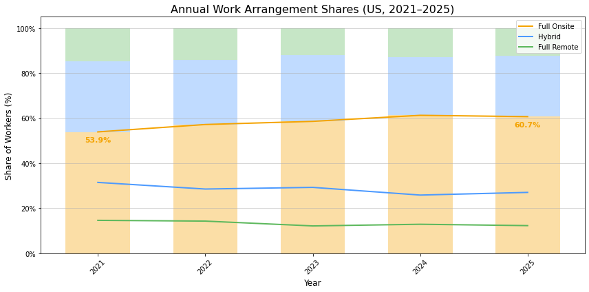
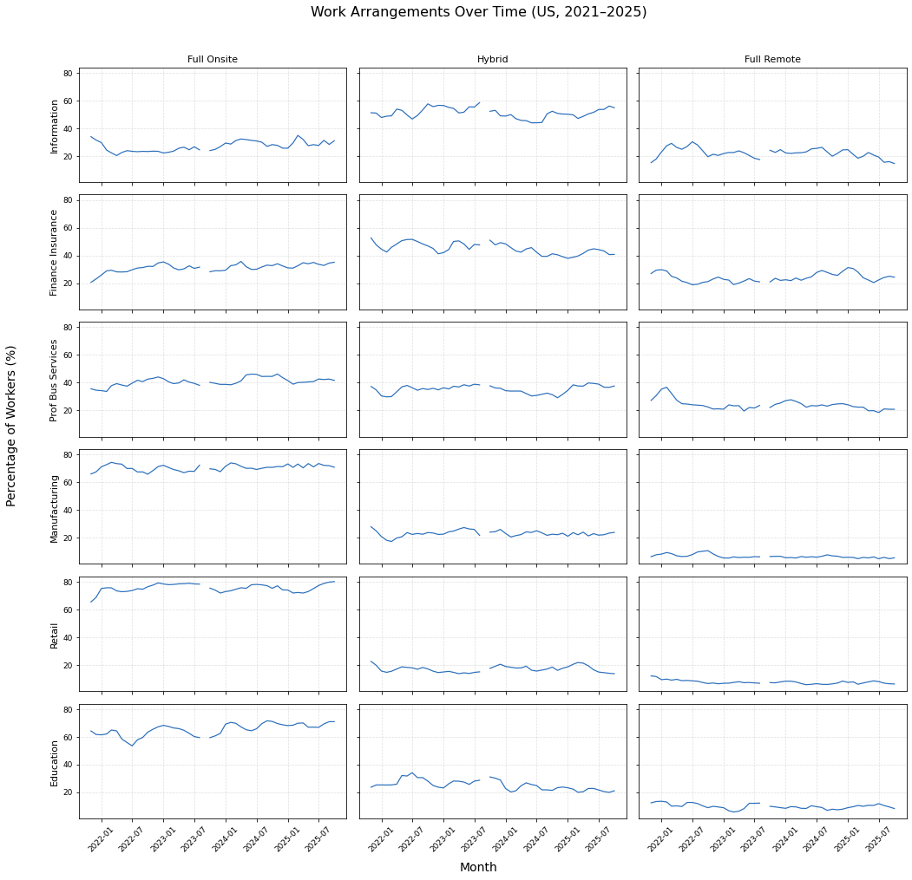

# Work-from-Home vs. Back-to-Office: Data Visualization

IE 6600 Computation and Visualization (Northeastern University) — Project 1

The project uses the WFH Research time series for the United States to show how work-from-home (WFH) changed before, during and after COVID-19: the overall WFH share, the split between full onsite, hybrid and fully remote work, differences between cities and industries, and the gap between the WFH days workers want and the days they get.

**Author:** Yi-Fan Liu

## Findings

From the [report](report/WFH_vs_BTO_Report.pdf):

- **Overall:** "From 1965 to 2019, the share of workdays spent working from home remained very low and relatively flat. When COVID-19 hit in 2020, the share spiked to nearly 50% of all workdays." By 2025, WFH still accounted for over 20% of workdays.
- **Work arrangements:** "The annual averages show that full-onsite work increased from about 54% in 2021 to around 61% in 2025. Hybrid and fully remote work declined slightly over the same period." (The notebook's annual chart labels these points 53.9% and 60.7%.)
- **Cities:** WFH shares were relatively high around 2021 and declined afterward. "Cities such as the Bay Area and New York retained higher WFH levels, while places like Miami and Houston saw steeper declines."
- **Industries:** "Information, Finance & Insurance, and Professional & Business Services consistently show the highest levels of hybrid and remote work." Education briefly increased hybrid work during the pandemic but returned to onsite teaching by 2023. Manufacturing and Retail stayed almost entirely onsite.
- **Employee satisfaction:** "For all workers, the net satisfaction score turns negative after 2021 and continues to decline through 2026". The gap is larger for workers whose jobs can be done remotely.
- **Conclusion:** the report recommends a hybrid-first approach.





## Approach

All charts in the notebook are made with pandas and matplotlib from `WFHtimeseries_monthly.xlsx`:

1. **By month:** equal-width 100% stacked bars (Marimekko style) of full onsite / hybrid / full remote shares, Nov 2021–Oct 2025, with a line for the onsite share.
2. **By year:** annual averages of the same three shares as lines over stacked bars.
3. **By city:** a 3 × 3 grid of small line charts (sparklines with axes) for nine metro areas, using the six-month moving average (MA6) series from Nov 2020. The report explains that the series starts in Nov 2020 because the October 2020 value uses only a 3-month window.
4. **By industry:** a matrix of small line charts with one row per industry and one column per arrangement, first for all 14 industries, then for six selected industries (Information, Finance & Insurance, Professional & Business Services, Manufacturing, Retail, Education).

## Repository contents

```
wfh_vs_bto.ipynb                 # notebook: all four chart sections, with outputs
WFHtimeseries_monthly.xlsx       # WFH Research data (CC BY 4.0), used by the notebook
report/
└── WFH_vs_BTO_Report.pdf        # 6-page report with charts and analysis
figures/
├── annual_work_arrangements.png       # chart from the "By year" cell
└── work_arrangements_by_industry.png  # chart from the "By Industry (choose 6)" cell
```

## How to run

1. Install the packages in [`requirements.txt`](requirements.txt) (`pandas`, `matplotlib`, `openpyxl`, `jupyter`). The notebook was run with Python 3.8.
2. Open `wfh_vs_bto.ipynb` in Jupyter from the repository folder and run all cells. The notebook reads `WFHtimeseries_monthly.xlsx` from the same folder (sheets "Full Remote-Hybrid-Full Onsite", "WFH by city" and "Work Arrangements by Industry").

**Data source:** WFH Research, https://wfhresearch.com/ (monthly time series file, data through October 2025). The file is made available under the CC BY 4.0 license. Suggested citation from the file: Barrero, Jose Maria, Nicholas Bloom, and Steven J. Davis, 2021. "Why working from home will stick," National Bureau of Economic Research Working Paper 28731. In the copy in this repository, the two contact email addresses on the README sheet were removed; the data is unchanged.

**Notes**
- The overview chart (1965–2025) and the employee-satisfaction chart in the report are not made in the notebook.
- The annual average for 2021 covers only November and December 2021, because the work-arrangement series starts in November 2021.
- In the monthly chart, the two highlighted points are labelled "0.54%" and "0.64%". The code formats the share as a fraction (0.54) with a % sign; the values are 54% and 64%, as the y-axis shows.
- The city and industry series have a gap at September 2023, where the source suppresses data because of data quality issues.
